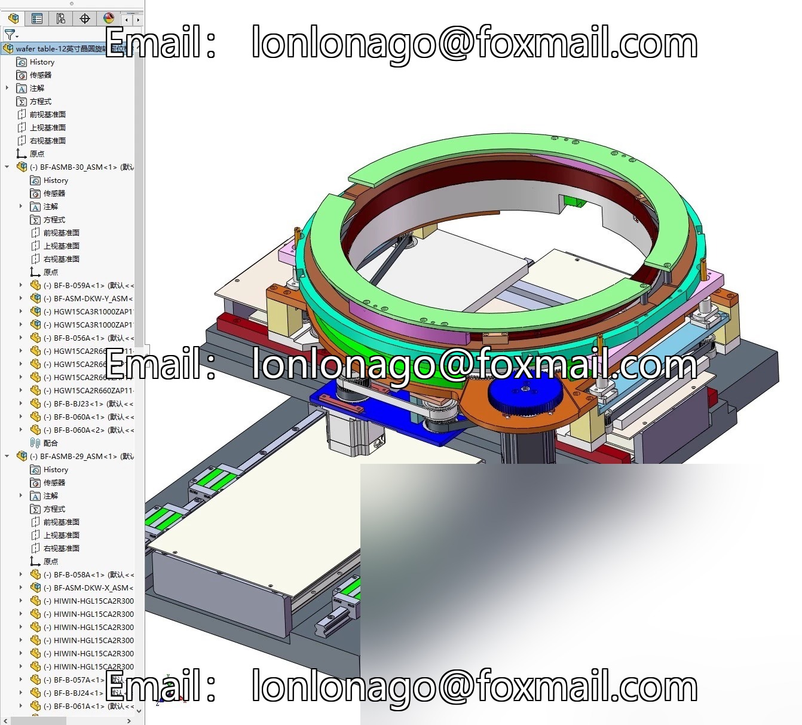

# Fixed-array machine 12-inch wafer stage XY + rotation and lifting

## Body

Mold Casting Machine 12-inch Wafer Chip Workstation XY+ Rotary and Lift-Up

It has detail, and thus has great reference value

Step assembly & sw2020 open saved parts
Editable (without parameters)

will directly take it down and leave their email, no response to details consultation, thank you.

Products not sold are non-refundable, technical support is not provided

The device is a 12-inch wafer table with XY plus rotation and lift functions, along with detailed assembly reference information.

<!-- AI_ENRICHED -->

## Images

## Payment

Here is a pay link on Stripe ( https://buy.stripe.com/3cs8yP7sY87d0vu9AB ). Please contact me lonlonago@foxmail.com after funding $89, and I will send you a complete data files , thank you!

